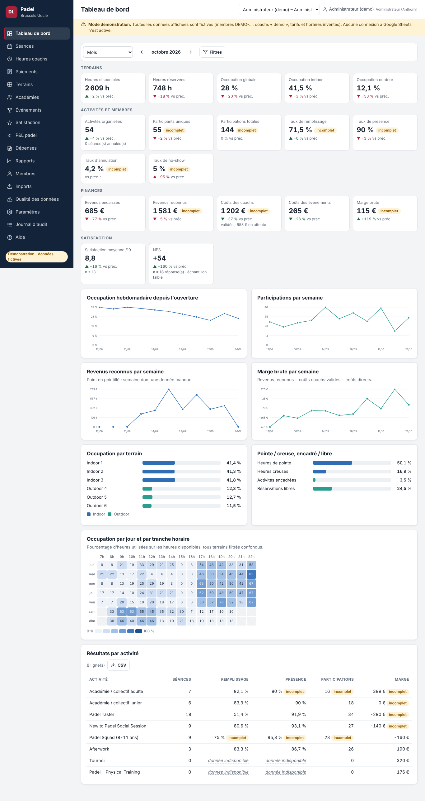
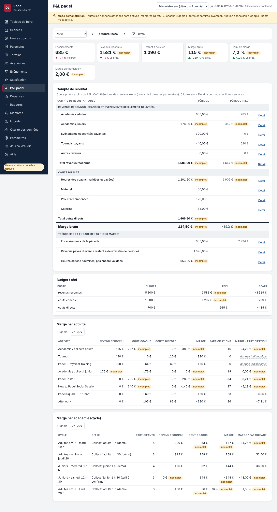
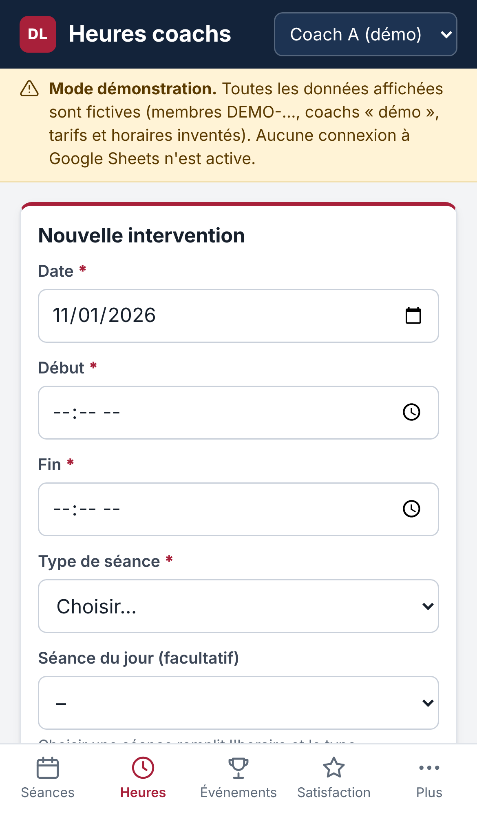

# Padel · David Lloyd Brussels Uccle – application de pilotage

Application web responsive (iPhone et ordinateur), en français, pour piloter le programme padel : occupation des six terrains, séances et présences, académies et cycles, heures et coûts des coachs, paiements, événements, satisfaction/NPS, P&L et rapports pour Anthony De Greef (Padel Manager) et Laurent Yernaux (General Manager).

**Google Sheets est la base de données** ; l'application est publiée par Google Apps Script depuis le classeur : aucun serveur, aucune clé dans le code.

> ⚠️ Aucune donnée réelle n'a été fournie. Le mode démonstration utilise un **jeu de données fictif** (membres `DEMO-…`, « Coach A (démo) », tarifs et horaires inventés). La connexion au vrai Google Sheets n'a pas pu être testée depuis l'environnement de développement : voir l'étape « Vérifier » du guide de connexion.

## Démarrage rapide

- **Voir la démo** : ouvrir `dist/demo/index.html` dans un navigateur. Sélecteur de rôle en haut à droite.
- **Mettre en production** : [docs/GUIDE_CONNEXION_GOOGLE_SHEETS.md](docs/GUIDE_CONNEXION_GOOGLE_SHEETS.md).

## Livrables

| # | Livrable | Emplacement |
|---|---|---|
| 1 | Application fonctionnelle | `dist/apps-script/` (production), `dist/demo/index.html` (démo) ; sources dans `src/` et `apps-script/` |
| 2 | Structure Google Sheets (18 onglets, colonnes, types, obligations, validations, relations) | [docs/STRUCTURE_GOOGLE_SHEETS.md](docs/STRUCTURE_GOOGLE_SHEETS.md) – créée automatiquement par `setupSpreadsheet()` |
| 3 | Jeu de données fictif clairement identifié | `src/data/demo-seed.js` (génération déterministe) |
| 4 | Assistant d'import CSV / Excel | Écran « Imports » ; logique `src/core/importer.js` |
| 5 | Quatre modèles de rapports | Écran « Rapports » ; `src/core/reports.js` ; exemples PDF fictifs dans `docs/exemples/` |
| 6 | Tests des principaux calculs | `tests/` – `npm test` (unitaires + serveur simulé), `npm run test:e2e` (navigateur) |
| 7 | Guide de connexion à Google Sheets | [docs/GUIDE_CONNEXION_GOOGLE_SHEETS.md](docs/GUIDE_CONNEXION_GOOGLE_SHEETS.md) |
| 8 | Guide d'installation et de déploiement | [docs/GUIDE_INSTALLATION_DEPLOIEMENT.md](docs/GUIDE_INSTALLATION_DEPLOIEMENT.md) |
| 9 | Guide utilisateur par rôle | [docs/GUIDE_UTILISATEUR.md](docs/GUIDE_UTILISATEUR.md) (aussi dans l'écran « Aide ») |
| 10 | Hypothèses, données manquantes et limites | [docs/HYPOTHESES_DONNEES_MANQUANTES_LIMITES.md](docs/HYPOTHESES_DONNEES_MANQUANTES_LIMITES.md) |
| 11 | Sauvegarde et restauration | [docs/SAUVEGARDE_RESTAURATION.md](docs/SAUVEGARDE_RESTAURATION.md) |
| 12 | Formules financières | [docs/FORMULES_FINANCIERES.md](docs/FORMULES_FINANCIERES.md) |
| + | Audit des sources et architecture | [docs/01_AUDIT_ET_ARCHITECTURE.md](docs/01_AUDIT_ET_ARCHITECTURE.md) |
| + | Matrice des permissions | [docs/MATRICE_PERMISSIONS.md](docs/MATRICE_PERMISSIONS.md) |

## Écrans

Tableau de bord · **Communauté & pénétration** (programme gratuit vs objectifs, indicateurs Power BI, taux de pénétration) · Séances (séance rapide, présences, génération des séances de cycle) · Heures coachs (saisie mobile, validation, paiement, synthèse) · Paiements · Terrains · Académies (cycles, inscriptions, offres) · Événements · Satisfaction / NPS · P&L (traçable ligne à ligne) · Dépenses · Rapports · Membres · Imports · Qualité des données · Paramètres (règles, taux historisés, types, niveaux, pointe, vacances, budget, terrains, utilisateurs, droits) · Journal d'audit · Aide.

## Développement

```bash
npm run build     # assemble dist/ et régénère la documentation de structure et de droits
npm test          # 36 tests : calculs, qualité, import, droits, rapports, serveur Apps Script simulé
npm run test:e2e  # Playwright : 18 écrans × 4 rôles × (iPhone, desktop) + parcours complets
npm run serve     # démo sur http://localhost:8080
```

Aucune dépendance npm. Code JavaScript sans framework, commenté ; logique métier pure dans `src/core/`, partagée entre l'interface et le serveur.

## Captures (données fictives)

| Tableau de bord | P&L | Heures coach (iPhone) |
|---|---|---|
|  |  |  |
